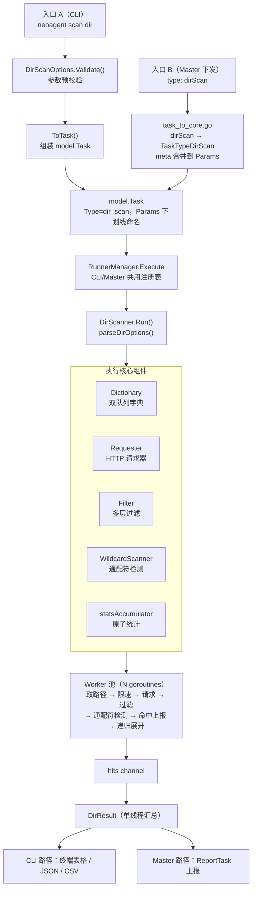

# DirScanner — 目录/文件扫描模块

- **版本**: v1.1
- **日期**: 2026-08-25
- **v1.1 变更**: 递归默认关闭（对齐 dirsearch）；新增 `--no-builtin`；新增实时进度输出；`--deep-recursive` 仅对目录类状态码展开；移除从未接线的 `-v/--verbose` 死参数（详细日志用根命令 `--log-level debug`）；新增连续超时熔断器（`--circuit-breaker`，默认 20，0=禁用）

DirScanner 是 NeoAgent 的目录与敏感文件扫描原子模块，移植自 dirsearch 的核心算法并用 Go 原生重写。内置通配符（动态 404）检测引擎，可有效避免 CDN/WAF 统一错误页造成的误报。

## 实现原理

### 整体流水线



### 核心机制

**1. 双队列字典（dict/dictionary.go）**

- `main` 队列：初始化时预加载（内置字典 + 用户字典 + 分类字典 + 自定义规则），经 %EXT% 展开、大小写变换、前后缀组合后只读
- `extra` 队列：递归扫描动态发现的子路径，**优先于 main 消费**，内部用 `seen` map 去重
- 条目上限 500,000（`maxSize`），限制的是唯一路径数而非总入队次数

**2. 真递归扫描（Phase 8 重构）**

命中目录（如 `/admin/` 返回 200/301/302/403）后，将**整个主字典在该目录前缀下重放**：

```
命中 /admin/ → 展开 /admin/<字典每条目> → /admin/config.php、/admin/login ...
```

- 递归深度 = 路径嵌套层数（`/admin/` 深度 1，`/admin/api/` 深度 2），无需额外状态
- 同一目录通过 `tryMarkExpand` 原子标记，只展开一次
- 三种模式：基础递归（仅目录）、深度递归（含所有父级目录）、强制递归（任意命中路径）
- **递归默认关闭**（对齐 dirsearch），需 `-r` 显式开启；`--deep-recursive`/`--force-recursive` 隐式开启递归
- 深度递归仅对目录类状态码（200/301/302/403）的命中展开：403 封禁页、400 畸形响应这类"命中"没有目录信息价值，对它们重放整本字典是纯粹的流量放大（实测：对反爬统一封禁页递归导致请求量 ×6.4，跑满 2h 任务超时）
- 含 `..` 的字典探测条目（目录穿越测试）不触发递归展开，避免生成畸形前缀

**3. 通配符检测（engine/scanner.go）**

识别"任意路径都返回同一动态内容"的通配符响应（典型如 CDN 统一 404 页）：

- **采样阶段**（每路径前缀一次性，`sync.Once` 保证）：向随机不存在路径发起 5 个探测请求，提取共同静态词作为基准
- **判定阶段**：响应归一化（UUID/长 hex/时间戳/Base64 替换为占位符）后与基准比对，同时检查词数膨胀比例（>1.35 倍判为独立内容）
- **指纹自校准**：同一响应指纹出现超过 10 次自动加入通配符黑名单
- 探测请求纳入并发控制：worker 持有限流槽位直到检测完成 + 内部信号量门控（容量 8）

**4. 多层过滤（engine/filter.go）**

按序执行：状态码白名单 → 状态码黑名单（默认 404/500/502/503）→ 响应大小黑名单 → 关键词排除 → 正则排除

**5. 统计（statsAccumulator）**

全部使用 `atomic.Int64` 无锁计数：总请求/成功响应/被过滤/通配符拦截/错误 + RTT 最大值/最小值/平均值。扫描结束后单线程 `Finalize()` 一次性转换。

**6. 实时进度输出（Progress）**

CLI 扫描默认开启（`-q` 关闭；server 模式不经 `ToTask()`，`progress` 参数缺省为 false，零侵入）。终端输出采用**单写入 goroutine 模型**：命中事件与 2 秒进度节拍在消费循环的同一个 `select` 中多路复用——全部终端写入只发生在一个 goroutine 里，输出顺序由结构保证，无需任何锁：

- **进度行**：stderr `\r` 原地覆写，包含已完成/已知总量、实时 req/s、hits/wildcard/filtered/err 计数、elapsed 与 ETA。递归动态追加队列时分母（已知工作量）会增长，进度百分比可能回退，与 dirsearch 行为一致
- **命中流式打印**：命中即时输出 `[hit]` 行到 stdout；stdout 是终端时先擦除当前进度行、命中换行后立即重画进度——命中行依次上滚，进度行始终停留在最后一行，两者永不互相覆盖
- 命中数由 `successful - filtered - wildcard` 推导（每个成功响应必走三者之一），不读 DirResult，无竞争
- 重定向到文件/管道时自动停用 `\r` 控制序列（`isTerminal` 检测），输出纯文本
- `--log-level debug` 时进度行自动退化为换行文本行（而非 `\r` 原地覆写），与 DEBU 日志流以换行原子行安全共存，两者均可见
- 逐请求详细日志使用根命令 `--log-level debug`（requester 的重试/退避等 Debugf 日志随之可见）

**7. 连续超时熔断器（circuitBreaker）**

目标进入丢包模式（WAF 封禁扫描 IP 的典型特征）时，超时重试数学上不可能成功，但每个路径要烧 3×timeout+退避——实测对 zhutix.com 扫描中 87% 的时间被扔进这个黑洞。熔断器以**连续超时计数**（成功响应即清零）区分"偶发失败"与"持续封禁"：达到阈值（默认 20，`--circuit-breaker` 可调，0=禁用）即取消整个扫描 context，worker 自然退出，stderr 输出熔断诊断，已完成的结果正常保留。

超时识别覆盖两种语义来源：网络层 i/o timeout（`ErrConnectionTimeout` 哨兵）与 `http.Client.Timeout` 本地计时器（`context.DeadlineExceeded`，classifyError 为保留 ctx 语义原样透传）——只判前者会导致熔断永不触发。

## 目录结构

```
internal/core/scanner/dir/
├── dir_scanner.go            # 主扫描器：Worker 池调度、递归控制、统计聚合、参数解析
├── dir_scanner_test.go       # 单元测试（含真递归断言、goroutine 泄漏检测）
├── dir_scanner_bench_test.go # 性能基准测试
├── dir_scanner_e2e_test.go   # 端到端验收测试
├── README.md                 # 本文档
│
├── dict/                     # 字典管理子包
│   ├── dictionary.go         # 双队列字典迭代器（main 只读 + extra 动态去重）
│   ├── template.go           # %EXT% 扩展名展开（Classic/Force 两种模式）
│   ├── wordlists.go          # 内置字典加载（go:embed）
│   └── wordlists/            # 内置字典数据文件
│       ├── dicc.txt          # 主字典（9,681 行，558 条含 %EXT%）
│       ├── categories/       # 技术栈分类字典（25 个，如 wordpress、spring）
│       └── user-agents.txt   # User-Agent 池（53 条）
│
├── engine/                   # 扫描引擎子包
│   ├── requester.go          # HTTP 请求器：连接池复用、重试退避、限速、代理、错误分类
│   ├── filter.go             # 多层响应过滤器 + Response 结构定义
│   └── scanner.go            # 通配符检测引擎（采样 + 指纹自校准）
│
└── result/                   # 结果对象子包
    └── result.go             # DirHit（单次命中）、DirResult（完整结果）、ScanStats（统计）
```

相关外部文件：

```
cmd/agent/scan/dir.go              # CLI 子命令：flag 注册、参数分级（--help/--help-all）
internal/core/options/scan_dir.go  # CLI 参数集合：Validate() 预校验、ToTask() 参数下发
internal/core/factory/dir_factory.go # 扫描器工厂（RunnerManager 注册用）
```

## 参数使用

### 参数分级

- `neoagent scan dir --help`：只显示 P0 常用参数（14 个）
- `neoagent scan dir --help-all`：显示全部参数（40 个，含高级参数）

### P0 常用参数

| 参数 | 短写 | 默认值 | 说明 |
|------|:---:|:---:|------|
| `--target` | `-t` | — | 目标 URL（也可用位置参数） |
| `--extensions` | `-e` | `php,asp,html,js,json,bak,git,env` | 扩展名列表，替换字典中的 `%EXT%` |
| `--wordlists` | `-w` | 内置字典 | 自定义字典文件（逗号分隔多个） |
| `--category` | — | — | 追加技术栈字典，如 `wordpress,spring` |
| `--threads` | — | 25 | 并发线程数（1~500） |
| `--timeout` | — | 10 | 单请求超时（秒，1~300） |
| `--recursive` | `-r` | false | 命中目录后递归扫描（流量放大，需显式开启） |
| `--force-extensions` | `-f` | false | 不含 %EXT% 的条目也追加扩展名变体 |
| `--exclude-status` | `-x` | `404,500,502,503` | 状态码黑名单 |
| `--max-recursion-depth` | `-R` | 3 | 最大递归深度（0~10） |
| `--quiet` | `-q` | false | 静默模式（同时关闭实时进度输出） |
| `--header` | `-H` | — | 自定义请求头，可多次指定 |
| `--method` | `-m` | GET | HTTP 方法 |
| `--targets-file` | `-l` | — | 批量目标文件（每行一个 URL） |

### P1/P2 高级参数（--help-all 可见）

| 参数 | 默认值 | 说明 |
|------|:---:|------|
| `--deep-recursive` | false | 深度递归：命中路径的所有父级目录也展开 |
| `--force-recursive` | false | 强制递归：任意命中路径都展开 ⚠️ 每个命中路径重放整个字典，流量急剧放大 |
| `--no-builtin` | false | 跳过内置字典，仅使用 `-w`/`--category` 指定的外部字典 |
| `--circuit-breaker` | 20 | 连续超时熔断阈值（0=禁用；目标丢包封禁时自动终止扫描） |
| `--proxy` | — | 代理地址 `http://127.0.0.1:8080` |
| `--follow-redirects` | false | 跟随 301/302 重定向 |
| `--max-retries` | 2 | 失败重试次数（指数退避，上限 5s） |
| `--rate-limit` | 0 | 每秒请求数上限（0=不限） |
| `--delay` | 0 | 每次请求间隔（毫秒） |
| `--max-time` | 0 | 整个扫描最长运行时间（秒） |
| `--target-max-time` | 0 | 单目标最长扫描时间（秒） |
| `--random-agent` | false | 内置 UA 池随机轮换 |
| `--prefixes` / `--suffixes` | — | 字典条目追加前/后缀（笛卡尔积） |
| `--uppercase` / `--lowercase` / `--capital` | false | 大小写变换（优先级 U > L > C） |
| `--include-status` | — | 状态码白名单（优先于黑名单） |
| `--exclude-text` | — | 响应体关键词排除，可多次指定 |
| `--exclude-regex` | — | 响应体正则排除 |
| `--exclude-size` | — | 响应体大小黑名单（字节） |
| `--headers-file` | — | 从文件加载请求头 |
| `--auth` | — | Basic Auth（`user:pass`） |
| `--user-agent` | — | 自定义 UA（优先级低于 --random-agent） |
| `--ip` / `--network-interface` | — | 绑定本地出口 IP / 网卡 |

### 使用示例

```bash
# 基本扫描（内置字典，默认不递归，带实时进度输出）
neoagent scan dir https://example.com

# 指定扩展名 + 技术栈字典（目标已知是 WordPress）
neoagent scan dir https://example.com -e php,bak --category wordpress

# 仅用自定义小字典（跳过内置字典，快速验证）
neoagent scan dir https://example.com -w mydict.txt --no-builtin

# 开启递归并限制深度 2
neoagent scan dir https://example.com -r -R 2

# 深度递归（隐式开启递归，仅对目录类状态码命中展开）
neoagent scan dir https://example.com --deep-recursive -R 2

# 低速率扫描（规避 WAF/限速）
neoagent scan dir https://example.com --rate-limit 10 --delay 100

# 带认证和自定义头
neoagent scan dir https://example.com --auth admin:secret -H "X-Token: abc123"

# 批量目标 + 结果导出
neoagent scan dir -l targets.txt -oJ result.json -oC result.csv

# 只看 200 和 403 的结果
neoagent scan dir https://example.com -i 200,403
```

### 环境变量

| 变量 | 说明 |
|------|------|
| `NEOSCAN_RULES_DIR` | 自定义字典目录（`*.txt` 自动加载），优先级高于默认的 `rules/dir/custom/` 相对路径搜索 |

## 编程调用与 Master 下发

DirScanner 实现 `runner.Runner` 接口，已注册到 `RunnerManager`（`manager.go`），CLI 与 Master 集群下发**共用同一个执行核心**，两条路径仅"任务来源和结果去向"不同，扫描行为完全一致。

### Master 下发链路

```
Master 任务 {"type": "dirScan", "target": "http://example.com", "meta": {...}}
    ↓  adapter/task_to_core.go: case "dir_scan"/"dirScan" → TaskTypeDirScan
    ↓  meta 逐条合并到 task.Params
RunnerManager.Execute(ctx, task)
    ↓  factory.NewDirScanner()（已注册）
DirScanner.Run() → parseDirOptions(task.Params)
```

### task.Params 参数契约

Master 下发时 `meta` 中的 key 必须使用**下划线命名**，与 `parseDirOptions()` 的解析约定一一对应。值的类型要求：`bool` 用 JSON 布尔，`int` 用 JSON 数字（`int`/`float64` 均兼容），列表用逗号分隔字符串。

| Params key | 类型 | 对应 CLI 参数 |
|------|:---:|------|
| `wordlists` | string | `--wordlists` |
| `category` | string | `--category` |
| `extensions` | string | `--extensions` |
| `force_extensions` | bool | `--force-extensions` |
| `prefixes` / `suffixes` | string | `--prefixes` / `--suffixes` |
| `uppercase` / `lowercase` / `capital` | bool | `-U` / `-L` / `-C` |
| `threads` | int | `--threads` |
| `timeout` | int（秒） | `--timeout` |
| `max_retries` | int | `--max-retries` |
| `method` | string | `--method` |
| `recursive` | bool | `--recursive` |
| `deep_recursive` | bool | `--deep-recursive` |
| `force_recursive` | bool | `--force-recursive` |
| `max_recursion_depth` | int | `--max-recursion-depth` |
| `rate_limit` | int | `--rate-limit` |
| `delay` | int（毫秒） | `--delay` |
| `max_time` / `target_max_time` | int（秒） | `--max-time` / `--target-max-time` |
| `include_status` / `exclude_status` | string | `--include-status` / `--exclude-status` |
| `exclude_size` | string | `--exclude-size` |
| `exclude_text` | string | `--exclude-text` |
| `exclude_regex` | string | `--exclude-regex` |
| `follow_redirects` | bool | `--follow-redirects` |
| `proxy` | string | `--proxy` |
| `random_agent` | bool | `--random-agent` |
| `user_agent` | string | `--user-agent` |
| `auth` | string（`user:pass`） | `--auth` |
| `headers` | string（多行 `Key: Value`） | `-H` / `--headers-file` |
| `ip` / `network_interface` | string | `--ip` / `--network-interface` |
| `skip_builtin` | bool | `--no-builtin` |
| `progress` | bool | （CLI 自动注入：默认 true，`-q` 时为 false） |
| `circuit_breaker` | int | `--circuit-breaker` |

### 编程调用示例

```go
manager := runner.NewRunnerManager()
task := &model.Task{
    ID:      "task-001",
    Type:    model.TaskTypeDirScan,
    Target:  "http://example.com",
    Timeout: 2 * time.Hour,
    Params: map[string]interface{}{
        "threads":             50,
        "extensions":          "php,bak",
        "category":            "wordpress",
        "recursive":           true,
        "max_recursion_depth": 2,
        "exclude_status":      "404,500",
    },
}
results, err := manager.Execute(ctx, task)
```

## 注意事项

1. **递归流量**：递归默认关闭（`-r` 显式开启，`--deep-recursive`/`--force-recursive` 隐式开启）。真递归下每个命中目录会重放整个主字典（内置字典展开后约 13,600 条），目标目录结构深时请评估流量并用 `-R` 限制深度。`--deep-recursive` 仅对目录类状态码（200/301/302/403）命中展开，含 `..` 的路径不触发展开。
2. **递归上限**：字典条目上限 500,000。内置字典约 13.6K 条，理论上第 36 个命中目录后递归展开会被截断（日志有 Warnf 提示，不中断扫描）。
3. **`--force-recursive` 警告**：命中文件（如 `/admin/config.php`）也会当目录展开，产生大量无效请求，仅建议在确认目标行为后使用。
4. **通配符站点**：目标对任意路径返回 200 时，通配符检测会自动识别并抑制误报，统计中的 `wildcard_reqs` 反映被拦截数量。
5. **HTTPS 证书**：默认跳过证书校验（`InsecureSkipVerify`），支持自签名站点。
